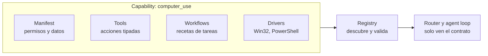

# Capabilities (plugins)

> Estado: propuesto (2026-11-21). Decisión en [ADR-0004](../decisions/0004-capabilities-como-plugins.md).

Una capability es el único mecanismo para agregar habilidades al harness. Computer use, chat, APIs externas y hardware cumplen el mismo contrato, así que el motor las trata igual.

## Contrato



| Pieza | Responsabilidad | Quién la ve |
|---|---|---|
| **Manifest** | Nombre, versión, canal (`stable`/`lab`), nivel de permiso por tool, sensibilidad de los datos que devuelve, dependencias | Registry, router, política |
| **Tools** | Funciones con argumentos validados con Pydantic y docstring útil para el modelo | El modelo (vía schema) |
| **Workflows** | Recetas deterministas que combinan tools y pasos de LLM | Router |
| **Drivers** | Código que toca el mundo real, detrás de una interfaz simulable | Solo sus propias tools |

## Niveles de permiso

| Nivel | Comportamiento | Ejemplo |
|---|---|---|
| `read` | Se ejecuta sin preguntar | `list_windows()` |
| `act` | Se ejecuta y queda en el log de auditoría | `open_app("spotify")` |
| `dangerous` | Siempre pide confirmación (Y/N en CLI, botones en Telegram) | `run_script(...)`, cerrar procesos |

## Esbozo del manifest

> Ilustrativo; el formato final se define en la Fase 1.

```yaml
name: computer_use
version: 0.1.0
channel: stable          # stable | lab
data_sensitivity: private # las salidas de estas tools fijan el run a local
tools:
  list_windows: { permission: read }
  open_app:     { permission: act }
  run_script:   { permission: dangerous }
limits:
  max_actions_per_run: 20
```

## Cómo encajan las capabilities futuras

- **APIs externas:** drivers HTTP. El manifest declara qué credenciales necesita (salen de la config, nunca del prompt) y qué datos manda fuera, para que la política bloquee fugas.
- **Hardware:** drivers serial/MQTT/GPIO. Además de `dangerous` y el kill switch, cada driver declara límites físicos (rangos válidos, máximo de acciones por minuto) que el runner hace cumplir sin importar lo que pida el modelo.
- **Lab:** un experimento es una capability con `channel: lab`. Promoverlo es mover la carpeta y cambiar el canal ([lab](lab.md)).

## Preguntas abiertas

- ¿Descubrimiento por entry points de Python o por carpeta escaneada?
- ¿El manifest vive en YAML o como objeto Python junto al código?
