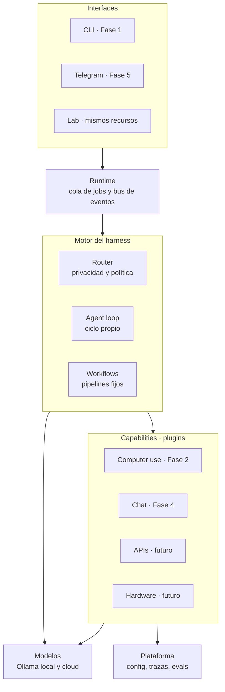
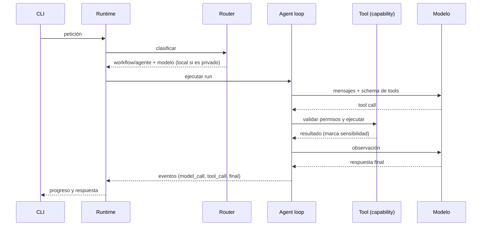

# Visión general y capas

> Estado: propuesto (2026-11-21). Nada de esto está implementado todavía.

## Objetivo

Un harness que use mis modelos locales (Ollama, solo CPU) para completar tareas, empezando por computer use básico en Windows y chat con memoria, y que crezca hacia APIs externas y control de hardware sin reescribir el núcleo.

## Principios

1. **Workflows antes que agentes.** Con modelos de 1 a 8B en CPU, la mayoría de las tareas son pipelines deterministas donde el LLM solo rellena pasos. El agente libre queda para tareas abiertas.
2. **Ciclo de agente propio.** Control total sobre el prompt, el parseo de tool calls, los reintentos y la salida estructurada ([ADR-0002](../decisions/0002-ciclo-de-agente-propio.md)).
3. **Puertos y adaptadores.** El núcleo no conoce Telegram, Ollama ni el sistema de archivos: todo entra por interfaces.
4. **Privacidad por defecto.** Lo privado nunca sale de la máquina ([enrutamiento](privacy-routing.md)).
5. **Todo se comunica por eventos.** Las interfaces, la telemetría y el lab se suscriben al mismo flujo de eventos.
6. **Medir antes de opinar.** Las evals dicen qué modelo resuelve qué tarea.

## Capas



**Regla de dependencias:** solo hacia abajo. Una capa conoce únicamente a la de abajo, y el motor nunca importa una capability concreta: las descubre en el registry. Nada se instancia al importar; todo se arma en un único *composition root* por aplicación.

## Estructura de carpetas prevista

```
packages/
  harness/
    core/        # dataclasses puras: Task, Message, ToolCall, Run, Event
    models/      # Protocol ModelProvider + adaptador Ollama (perfiles local/cloud)
    tools/       # registry, contrato de capabilities, permisos
    agent/       # ciclo: modelo → tool calls → ejecutar → observar → parada
    workflows/   # motor de workflows
    router/      # clasificación y política de privacidad
    memory/      # conversaciones y artefactos (SQLite)
    runtime/     # cola de jobs, bus de eventos
    telemetry/   # trazas JSONL, métricas de hardware, redacción de secretos
    config/      # pydantic-settings, models.yaml, policy.yaml
    evals/       # runner de evals
  capabilities/
    computer_use/
apps/
  cli/
  telegram/
lab/
  experiments/
  sandbox.py
legacy/          # código del bot anterior, temporal
```

## Flujo de una petición



## Documentos relacionados

- [Capabilities](capabilities.md) · [Privacidad](privacy-routing.md) · [Lab](lab.md) · [Computer use](computer-use.md)
- [Roadmap](../roadmap.md)
