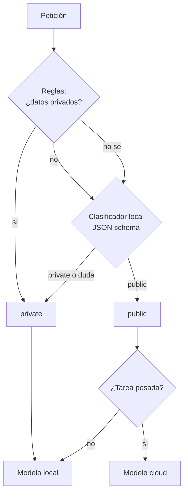

# Enrutamiento por privacidad

> Estado: propuesto (2026-11-21). Decisión en [ADR-0003](../decisions/0003-enrutamiento-por-privacidad.md). Se implementa en la Fase 3.

El router decide a qué modelo va cada paso de un run. El criterio principal es la privacidad de los datos; el segundo, el peso de la tarea.

## Perfiles de modelo

Cada perfil declara su `locality`. Ollama sirve modelos locales y cloud por el mismo daemon, así que el proveedor es uno solo y la diferencia vive en el perfil.

```yaml
# config/models.yaml (ilustrativo)
light:    { model: gemma4:e2b,       locality: local, num_ctx: 8192 }
standard: { model: gemma4:e4b,       locality: local, num_ctx: 8192 }
fast:     { model: llama3.1:8b,      locality: local, supports_tools: true }
cloud:    { model: gemma4:31b-cloud, locality: cloud }
```

## Decisión en tres pasos



1. **Clasificar la sensibilidad.**
   - Reglas: ubicación, nombres, rutas de archivos, correos, números, datos de cuentas.
   - Si las reglas no deciden: un modelo local chico devuelve `{"sensitivity": "private|public"}`.
2. **Contexto contaminado.** Si en cualquier momento entra un dato privado (resultado de una tool del PC, memoria personal, archivo leído), el run entero queda fijado a local. Evita la fuga típica: la pregunta es pública, una tool devuelve datos tuyos y la siguiente llamada se va a la nube.
3. **Política.**

| Sensibilidad | Tarea | Destino |
|---|---|---|
| private | cualquiera | local, siempre |
| public | pesada (razonamiento largo, mucho texto) | cloud |
| public | ligera | local |
| duda | cualquiera | local |

## Consecuencias prácticas

- Computer use siempre es local: sus tools devuelven datos privados.
- El chat general puede ir a la nube mientras no toque contexto personal.
- La política vive en `config/policy.yaml` y cada traza registra por qué se eligió cada modelo.

## Pruebas obligatorias

Tests que demuestren que ningún mensaje marcado `private` llega a un perfil con `locality: cloud`, incluyendo el caso de contaminación a mitad del run.
