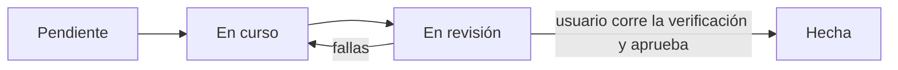

# Tareas de implementación

Cada fase del [roadmap](../roadmap.md) se divide en tareas. Una tarea es como un ticket: trae todo lo necesario para implementarla sin leer el resto de la documentación. Las referencias a `architecture/` y `decisions/` están al final de cada tarea, por si hay dudas.

## Flujo de una tarea

1. El usuario abre una sesión y nombra la tarea (`T1.2`).
2. El agente lee solo ese archivo, implementa el código y los tests que pide, y la deja **En revisión** con sus notas.
3. El usuario corre los comandos de **Verificación**. Si algo falla, trae el resultado a la sesión.
4. Cuando el usuario aprueba, la tarea queda **Hecha**, se hace el commit y se marca en esta tabla.

Las reglas completas están en [AGENTS.md](../../AGENTS.md).

## Índice

| ID | Tarea | Depende de | Estado |
|---|---|---|---|
| **Fase 1: base y CLI** | | | |
| [T1.1](fase-1-base/T1.1-workspace-legacy-tooling.md) | Workspace, legacy y tooling | — | Pendiente |
| [T1.2](fase-1-base/T1.2-core-config-proveedor.md) | Core, config y proveedor Ollama | T1.1 | Pendiente |
| [T1.3](fase-1-base/T1.3-telemetria-y-cli-chat.md) | Telemetría y `harness chat` | T1.2 | Pendiente |
| [T1.4](fase-1-base/T1.4-contrato-capabilities-y-lab.md) | Contrato de capabilities y lab | T1.2 | Pendiente |
| **Fase 2: agente y computer use** | | | |
| [T2.1](fase-2-agente-computer-use/T2.1-agent-loop.md) | Agent loop | T1.3 | Pendiente |
| [T2.2](fase-2-agente-computer-use/T2.2-permisos-confirmacion-auditoria.md) | Permisos, confirmación y auditoría | T1.4, T2.1 | Pendiente |
| [T2.3](fase-2-agente-computer-use/T2.3-capability-computer-use.md) | Capability computer use | T2.2 | Pendiente |
| [T2.4](fase-2-agente-computer-use/T2.4-workflows-y-harness-run.md) | Workflows y `harness run` | T2.3 | Pendiente |
| **Fase 3: privacidad** | | | |
| [T3.1](fase-3-privacidad/T3.1-politica-y-router.md) | Política y router por reglas | T1.3 | Pendiente |
| [T3.2](fase-3-privacidad/T3.2-clasificador-y-contaminacion.md) | Clasificador local y contexto contaminado | T3.1, T2.1 | Pendiente |
| **Fase 4: chat con memoria** | | | |
| [T4.1](fase-4-memoria/T4.1-memoria-sqlite.md) | Memoria en SQLite | T3.2 | Pendiente |
| [T4.2](fase-4-memoria/T4.2-capability-chat.md) | Capability chat con memoria | T4.1 | Pendiente |
| **Fase 5: Telegram y cola de jobs** | | | |
| [T5.1](fase-5-telegram/T5.1-runtime-cola-y-eventos.md) | Runtime: cola de jobs y bus de eventos | T4.2 | Pendiente |
| [T5.2](fase-5-telegram/T5.2-adaptador-telegram.md) | Adaptador de Telegram | T5.1 | Pendiente |
| [T5.3](fase-5-telegram/T5.3-retirar-legacy.md) | Retirar `legacy/` | T5.2 | Pendiente |
| **Continuo: evals** | | | |
| [TE.1](continuo-evals/TE.1-runner-de-evals.md) | Runner de evals | T1.3 | Pendiente |
| [TE.2](continuo-evals/TE.2-suites-iniciales.md) | Suites iniciales | TE.1, T3.2 | Pendiente |

Las tareas de evals no bloquean las fases. TE.1 puede hacerse en cuanto exista T1.3.

## Backlog (sin fase todavía)

- **Capability de documentos:** rescatar de `legacy/` la conversión MD→PDF (`needle_tools._markdown_to_pdf_bytes`) y `word_tools` como capability `documents`. Se convierte en tarea cuando haya una fase para ella. Debe hacerse antes de T5.3 o antes hay que copiar esas piezas fuera de `legacy/`.
- **Adaptadores futuros:** APIs externas, hardware, MCP como driver.

## Cómo escribir una tarea nueva

- Copia la [plantilla](_template.md) dentro de la carpeta de su fase, con el nombre `T<fase>.<n>-<tema>.md`.
- **Contexto mínimo** resume lo que el agente necesita saber. Si para entender la tarea hay que leer tres documentos, la tarea está mal escrita.
- Debe ser significativa: una sesión de agente debe producir algo que se pueda verificar. Ni "renombrar una variable" ni "toda la fase" si la fase es grande.
- Los tests listados son los mínimos que prueban que funciona, no una cobertura completa.
- Agrega la fila a la tabla de arriba.
